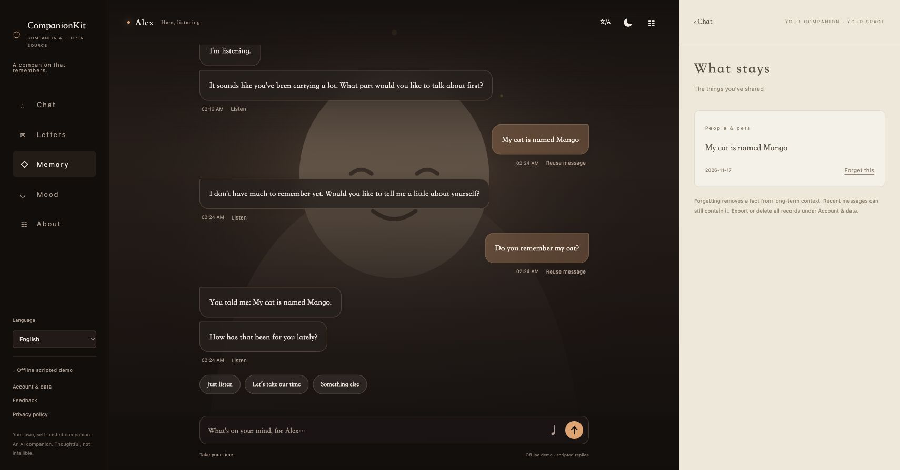

# CompanionKit

A self-hosted companion AI, with a complete web application and reusable components.

**[简体中文](README.zh-CN.md)** · [Language configuration](docs/i18n.md) · [Architecture](docs/architecture.md) · [Product coverage](docs/web-port.md)



CompanionKit brings together continuous conversations, suggested reply chips, long-term memory, mood check-ins, weekly letters and companion settings. It is a general-purpose companion, with configurable branding, appearance and language. The web application uses the same components exposed in `packages/`.

## Run locally

Requires **Node.js 24+**. No third-party runtime dependencies or cloud account are required for the offline demo.

```sh
npm start
# or: node --env-file-if-exists=.env apps/web/server.js
```

Open <http://127.0.0.1:4317>. The offline demo is explicitly labeled and uses limited scripted responses; it is not a model-quality demonstration.

To use a real model, copy `.env.example` to `.env`:

```dotenv
MODEL_PROVIDER=openai-compatible
LLM_BASE_URL=https://your-provider.example/v1
LLM_API_KEY=your-key
LLM_MODEL=your-model
```

The adapter uses `/chat/completions` for replies and structured analysis. Provider compatibility must be verified for your chosen model. Conversations, analysis, summaries and letters may incur API costs. Credentials stay on the server.

## Complete web experience

- Streaming conversation, multiple message bubbles, saved history, older-message loading and reconnection recovery.
- Reply chips parsed from the model stream, first-meeting prompts and returning-user continuations. Protocol markers never appear as visible message text.
- Typed long-term memories, importance and recency ranking, expiry, deduplication, reinforcement and user-controlled forgetting.
- Memory and name-change confirmation banners, with undo actions.
- Mood calendar, daily check-ins and explicit-mood extraction; manual check-ins take priority.
- Weekly letters and saved past letters, manually requested or optionally scheduled on Sundays.
- Companion appearance, name, conversation style, relationship preference, nickname, city and day/night themes.
- Guest sessions, account registration/sign-in, feedback with screenshots, experience survey, data export and account deletion.
- Browser speech input and reading aloud when supported. Browser permission is requested only after the user starts voice input.

Commercial payment integration is not included. This self-hosted edition has no subscription restriction and does not connect to the original product's merchant accounts.

## Languages are configuration

English and Simplified Chinese ship with the repository. Users can switch the interface and reply language without reloading. The default language, fallback, browser detection, enabled locales, speech locale, text direction, brand and timezone are configured in `companion.config.json`.

```json
{
  "i18n": {
    "defaultLocale": "en",
    "fallbackLocale": "en",
    "detectBrowserLanguage": false,
    "locales": [
      { "code": "en", "label": "English", "file": "packages/i18n/locales/en.json", "speechLocale": "en-US", "direction": "ltr" },
      { "code": "zh-CN", "label": "简体中文", "file": "packages/i18n/locales/zh-CN.json", "speechLocale": "zh-CN", "direction": "ltr" }
    ]
  }
}
```

Add a translation JSON and one locale entry to support another language. Missing messages fall back to the configured catalogue. Stored conversations, memories and letters retain their original language. See [the full configuration guide](docs/i18n.md).

## Reusable components

| Package | Responsibility |
|---|---|
| `packages/conversation` | Chips, stream protocol, multi-bubble messages and returning-user behavior |
| `packages/memory` | Storage-independent extraction, ranking, TTL, reinforcement and deletion |
| `packages/ui` | Injected chat view, panels, dialogs, voice and privacy components |
| `packages/providers` | OpenAI-compatible adapter, companion prompts and clearly labeled demo model |
| `packages/storage` | Account/session repository and serialized JSON persistence |
| `packages/i18n` | Locale loading, interpolation, runtime switching and fallback |
| `packages/companion-core` | Profile defaults, mood rules and weekly-letter service |
| `apps/web` | HTTP/SSE host and application composition |

For example, the memory engine works without the web application:

```js
import { MemoryEngine, InMemoryStore } from './packages/memory/index.js';
const memory = new MemoryEngine({ store: new InMemoryStore() });
await memory.remember('user-1', {
  type: 'preference', content: 'The user likes hiking', importance: 3
});
console.log(await memory.context('user-1'));
```

The UI components accept state and behavior through callbacks. The mood and letter services accept repositories and models. No component requires a WeChat or CloudBase account. Package names are workspace names; they have not been published to npm.

## Docker

```sh
docker compose up --build
```

Open <http://localhost:4317>. A named volume preserves records. For a public deployment, set `PUBLIC_ORIGIN` to the exact HTTPS origin and configure your reverse proxy. The sample Compose configuration binds its published port to loopback.

## Tests

```sh
npm test
npm run eval
```

The automated suite covers conversations, protocol buffering, English chips, locale configuration and fallback, memory isolation, account lifecycle, persistence, reconnection, idempotency, moods and letters. Tests use synthetic records and mocked model responses. The separate 12-case gate check is a deterministic smoke check, not an LLM benchmark. See [verification notes](docs/validation.md).

## Practical limits

- JSON persistence is for a single Node process, with one repository instance per data file. Use a transactional database adapter before scaling to multiple processes.
- Memory deduplication is exact, not semantic. Contradictory facts are not automatically resolved; current corrections are prioritized in the prompt, and users can forget old memories.
- Forgetting removes a memory from future long-term context but leaves the source conversation. Account deletion removes that account's records; external backups follow the operator's retention policy.
- Registration uses a local email/password account. Email verification, password recovery and external OAuth are not implemented.
- Browser voice support varies and may use the browser vendor's service. Actual model behavior and new languages require evaluation with the chosen provider. RTL metadata is supported but has not been comprehensively visually tested.
- This is AI companionship, not professional medical or mental-health care.

## License and provenance

Source code is available under [MIT](LICENSE). Product copy and continuation helpers were ported from the owner's personal companion application; see [provenance](docs/provenance.md). No company code, private production history, credentials or real user samples are included. Optional portrait assets retain their original generation marking; the default abstract avatar is repository-native SVG.
