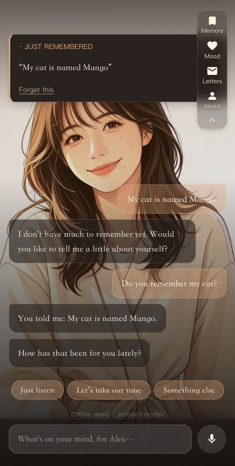
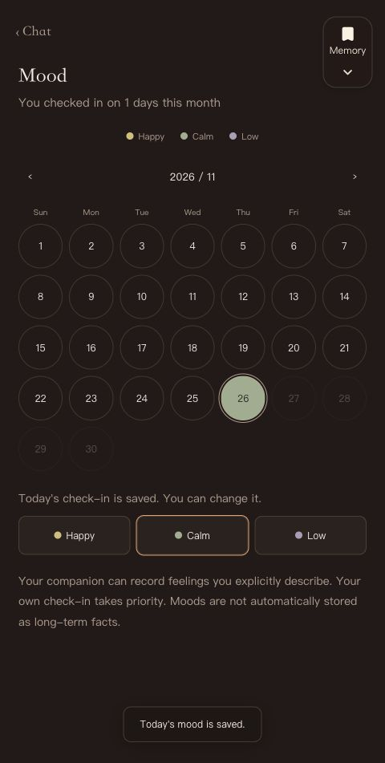
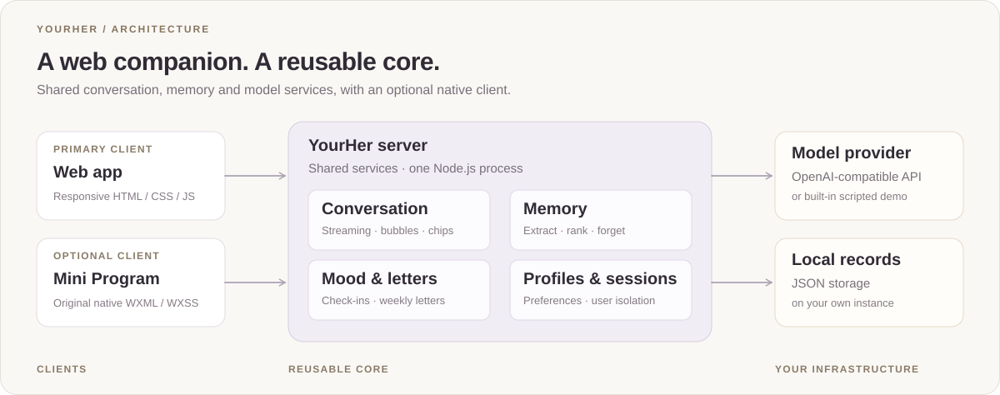

<div align="center">

# YourHer

### 开源 AI 陪伴应用，内置带长期记忆的对话 Agent，支持自托管

`AI 陪伴` · `对话 Agent` · `长期记忆` · `自托管`

[](https://github.com/DZ9/YourHer/actions/workflows/ci.yml)
[](LICENSE)
[](https://nodejs.org/)

[快速启动](#快速启动) · [Agent 架构](#agent-工作原理) · [多语言配置](docs/i18n.md) · [架构](docs/architecture.md)

[English](README.md) · 简体中文

</div>

<p align="center">
  
  
  
</p>

聊天页展示流式回复和续聊建议，记忆页可以查看或删除单条事实，心情页可以打卡和浏览月历。

## Agent 工作原理

每轮先把陪伴者设定、近期消息、对话摘要和筛选过的长期记忆组装成上下文，再通过 OpenAI 兼容接口生成流式回复。服务端先保存回复，随后按规则决定是否抽取事实，供后续对话使用。

[](docs/architecture.md)

### 试一次跨轮记忆

1. 在离线演示里发送 **“My cat is named Mango.”**。看到记忆提示后，打开 **Memory** 查看已保存的事实。
2. 回到聊天问 **“Do you remember my cat?”**。回复会提到 Mango。上面的截图来自这组使用合成数据的规则演示。

### 技术决策

| 决策 | 带来的变化 |
| --- | --- |
| 先保存回复，再抽取记忆 | 抽取失败时已经保存的回复仍可用。网页端也可按请求编号取回已完成的对话轮次。 |
| 按用户管理显式记忆 | 事实有类型、精确去重、排序和过期规则。用户可查看或删除单条记忆，近期聊天原文仍可能包含该事实。 |
| 两端共用同一套后端 | 网页端通过 SSE 接收流式回复，可选的小程序客户端通过轮询更新。两端复用对话与记忆逻辑。 |

可复现检查见[验证记录](docs/validation.md)和 [CI](https://github.com/DZ9/YourHer/actions/workflows/ci.yml)。运行 `npm run eval` 可检查记忆门控规则。

## 快速启动

需要 Node.js 24+，内置演示不需要安装第三方依赖。

```sh
git clone https://github.com/DZ9/YourHer.git
cd YourHer
npm start
```

打开 **[localhost:4317](http://localhost:4317)**。默认是明确标注的离线规则演示，不代表模型效果。

<details><summary><strong>接入真实模型</strong></summary>

复制 `.env.example` 为 `.env`，填写后重启：

```dotenv
MODEL_PROVIDER=openai-compatible
LLM_BASE_URL=https://your-provider.example/v1
LLM_API_KEY=your-key
LLM_MODEL=your-model
```

密钥留在服务端。回复、信息抽取、摘要和信件可能分别调用 API，请核对所选提供方的兼容性和费用。

</details>

## 功能

| 功能 | 提供的能力 |
| --- | --- |
| 对话 | 流式多气泡、续聊建议与聊天历史 |
| 记忆 | 保存事实与偏好，查看和删除单条记忆 |
| 个性设置 | 自定义名字、外观、说话风格，切换日夜主题 |
| 日常记录 | 心情打卡、月历与每周信件 |
| 数据管理 | 自托管、导出记录与删除账户数据 |

网页内置英文和简体中文。新增语言与修改默认设置见[多语言配置指南](docs/i18n.md)。

## 组件

应用共用对话、记忆和模型处理逻辑，各个包也可以单独用于其他项目。

包的职责与记忆模块接入示例见[组件指南](docs/components.md)。

## 客户端

| 客户端 | 启动方式 | 状态 |
| --- | --- | --- |
| **网页版** | [快速启动](#快速启动) | 主要客户端 · 英文与中文 |
| 微信小程序 | [启动指南](docs/miniapp.md) | 可选原生客户端 · 中文界面 |

<details>
<summary>关于可选的小程序客户端</summary>

保留原版 WXML/WXSS 页面、人物立绘和聊天交互，连接同一套后端。需要微信开发者工具，以及你自己的 AppID 或测试号。核心聊天流程已在微信开发者工具里验收，真机预览仍待验证。模型回复语言可配置，界面仍为中文。

本地网络与可选语音插件的配置见[小程序启动指南](docs/miniapp.md)。

</details>

## 文档

[开发指南](docs/development.md)

## 许可证

本项目采用 [MIT 许可证](LICENSE)。
