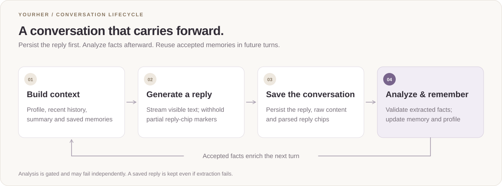

<div align="center">

# YourHer

### 熟悉的声音，慢慢建立的联结。

有个性、能记忆、可以持续交流的自托管 AI 陪伴。

[](https://github.com/DZ9/YourHer/actions/workflows/ci.yml)
[](LICENSE)
[](https://nodejs.org/)

[快速启动](#快速启动) · [功能](#功能) · [多语言配置](docs/i18n.md) · [架构](docs/architecture.md)

[English](README.md) · 简体中文

</div>

<p align="center">
  
  
  
</p>

YourHer 是可以自己部署的 AI 陪伴应用。选择陪伴者的名字、外观和说话风格，接入模型，聊聊日常，再回来接着聊。

可以直接部署网页版，也可以将对话、记忆等组件用于自己的项目。

## 快速启动

需要 Node.js 24+，内置演示不需要安装第三方依赖。

```sh
git clone https://github.com/DZ9/YourHer.git
cd YourHer
npm start
```

打开 **[localhost:4317](http://localhost:4317)**。默认是明确标注的离线规则演示，不代表模型效果。

<details><summary><strong>接入真实模型</strong></summary>

复制 `.env.example` 为 `.env`，填写后重启：

```dotenv
MODEL_PROVIDER=openai-compatible
LLM_BASE_URL=https://your-provider.example/v1
LLM_API_KEY=your-key
LLM_MODEL=your-model
```

密钥留在服务端。回复、信息抽取、摘要和信件可能分别调用 API，请核对所选提供方的兼容性和费用。

</details>

## 功能

| 功能 | 提供的能力 |
| --- | --- |
| 对话 | 流式多气泡、续聊建议与聊天历史 |
| 记忆 | 保存事实与偏好，查看和删除单条记忆 |
| 个性设置 | 自定义名字、外观、说话风格，切换日夜主题 |
| 日常记录 | 心情打卡、月历与每周信件 |
| 数据管理 | 自托管、导出记录与删除账户数据 |

网页内置英文和简体中文。新增语言与修改默认设置见[多语言配置指南](docs/i18n.md)。

## 工作原理

网页的模型调用、记忆处理和数据存储统一在你自己的服务器上完成。


回复先保存，再进行可选的信息抽取。通过验证的记忆参与后续对话；抽取失败不会丢失已经保存的回复。



## 组件

应用共用对话、记忆和模型处理逻辑，各个包也可以单独用于其他项目。

包的职责与记忆模块接入示例见[组件指南](docs/components.md)。

## 客户端

| 客户端 | 启动方式 | 状态 |
| --- | --- | --- |
| **网页版** | [快速启动](#快速启动) | 主要客户端 · 英文与中文 |
| 微信小程序 | [启动指南](docs/miniapp.md) | 可选原生客户端 · 中文界面 |

<details>
<summary>关于可选的小程序客户端</summary>

保留原版 WXML/WXSS 页面、人物立绘和聊天交互，连接同一套后端。需要微信开发者工具，以及你自己的 AppID 或测试号。开发者工具编译和真机预览尚未验收。模型回复语言可配置，界面仍为中文。

本地网络与可选语音插件的配置见[小程序启动指南](docs/miniapp.md)。

</details>

## 文档与开发

- [多语言配置](docs/i18n.md)
- [贡献指南](.github/CONTRIBUTING.md)

```sh
npm test
npm run eval
```

目前 JSON 持久化仅支持单进程；尚无语义冲突自动解决、邮件验证、找回密码或 OAuth。真实模型、浏览器语音、Docker 和 RTL 需要实际环境验收。自托管版没有订阅限制，也不连接原商户支付。

## 许可证

[MIT](LICENSE) · [来源说明](docs/provenance.md) · [第三方声明](docs/third-party-notices.md)
